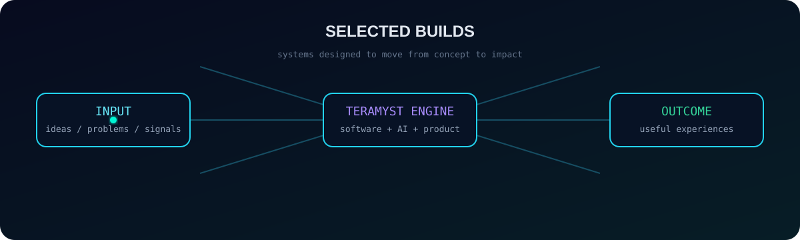
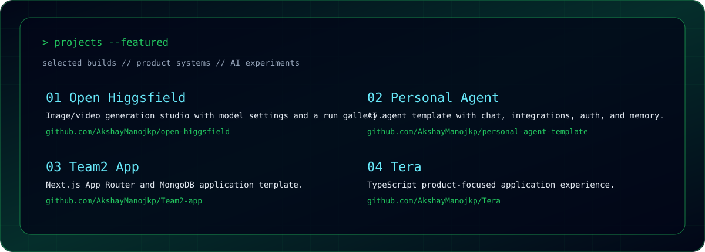
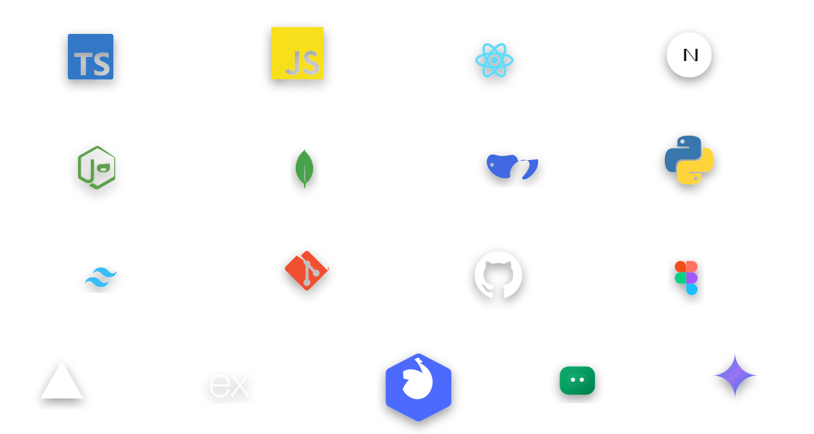
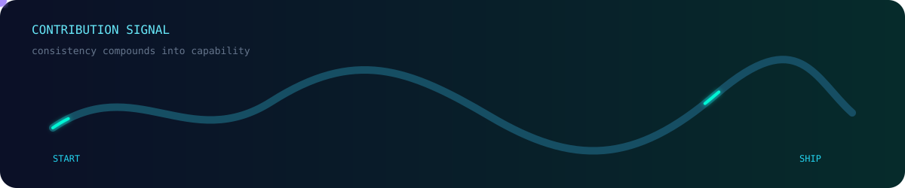

  

  

   

  
  
  

<!-- ============ WELCOME NOTE ============ -->

### 🌌 Welcome to my digital universe / 私のデジタル宇宙へようこそ

*Where the quest for magic meets the rigor of engineering — and Artificial Intelligence bridges imagination with reality.* 
*ここでは「魔法の探求」と「エンジニアリングの精密さ」が出会い、人工知能が想像と現実を結ぶ架け橋となります。*

<!-- ============ END WELCOME NOTE ============ -->

 

  

 

<!-- ============ CURRENT ORBIT ============ -->

  
    
  
   
  
   
  

 

<!-- ============ SYSTEM ARCHITECTURE ============ -->

  
    
  

 

<!-- ============ CURRENT FOCUS ============ -->

  
    
  

 

<!-- ============ TECH ARSENAL ============ -->

  
    
  
    
  
  
  
  
  
  

 

<!-- ============ CONTRIBUTION SIGNAL ============ -->

  
    
  

 

<!-- ============ PRINCIPLES ============ -->

  

> **Build clearly. Learn in public. Reduce complexity. Ship useful things.**
>
> I care about clean interfaces, fast feedback loops, durable foundations, and technology that creates real leverage for people.

  

  
   
  

